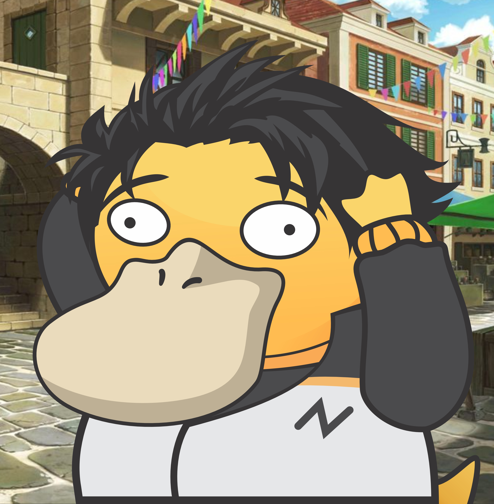
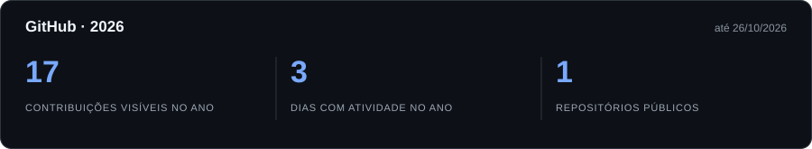
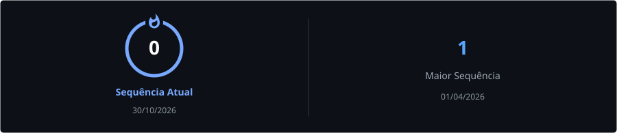

  
  

## Sobre mim

  

Sou <strong>Kauã</strong>, curso <strong>Ciência da Computação na UNIVASF</strong>. 📍 Salgueiro, Pernambuco, Brasil

Compartilho meus estudos e projetos de programação, desenvolvimento web e um pouco de criação de jogos.

   Windows 11
  &nbsp;·&nbsp;
   Fedora KDE Plasma 44

  

## Tecnologias

  
  
  
  
  
  

## Atividade no GitHub

## Contribuições

<!-- snake:start -->
<picture>
  <source media="(prefers-color-scheme: dark)" srcset="./assets/github-snake-month-dark.svg">
  <source media="(prefers-color-scheme: light)" srcset="./assets/github-snake-month.svg">
  
</picture>
<!-- snake:end -->

 

